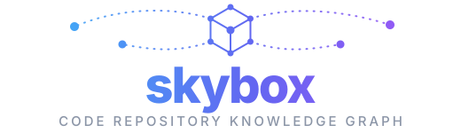
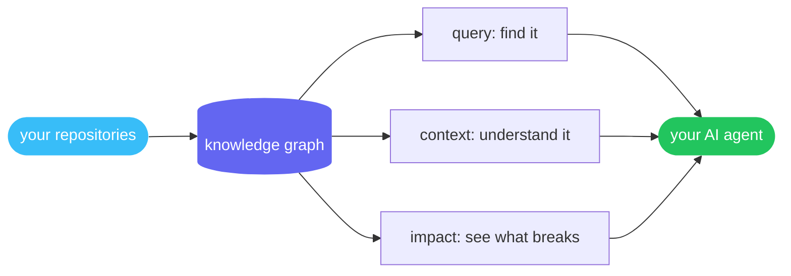

<div align="center">



<br/>

**Know what breaks before you change it.**

<br/>


</div>

---

## What is skybox?

skybox reads your repositories and builds a knowledge graph of them: every function, class and route, and how they call each other. Your AI coding agent then asks the graph instead of grepping and guessing:

> **Where is it? How does it work? What breaks if I change it?**



## Try it

```bash
npm install -g @skylence-ai/skybox
skybox setup      # connects skybox to your coding agent
skybox index .    # index the current repository
```

**TL;DR**: one binary on your own machine. It indexes your code into a graph, and your agent uses it to find, understand and safely change that code, across one repository or many.

<br/>

<div align="center">

Built by **[Skylence](https://skylence.be)**

</div>
